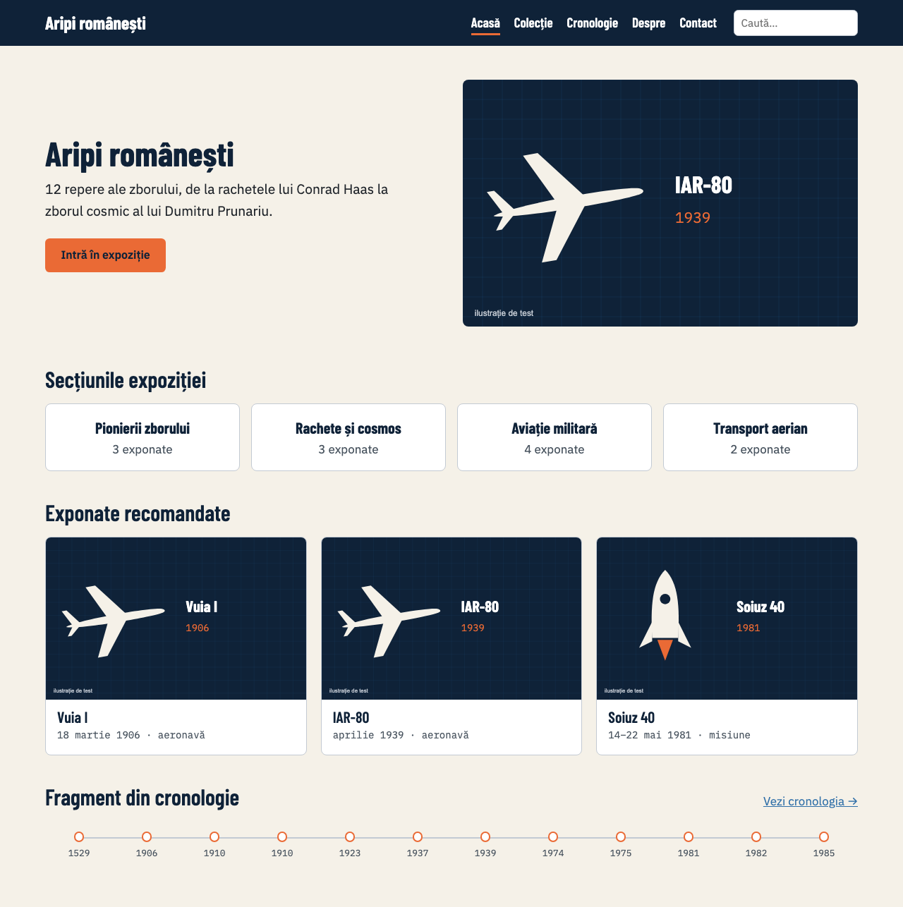
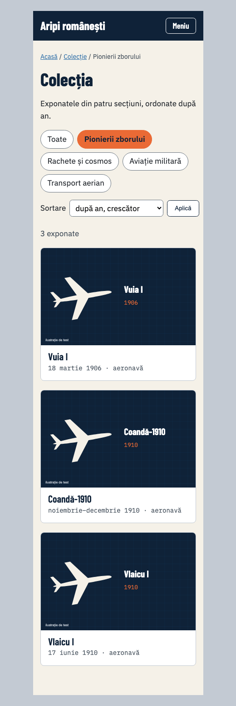
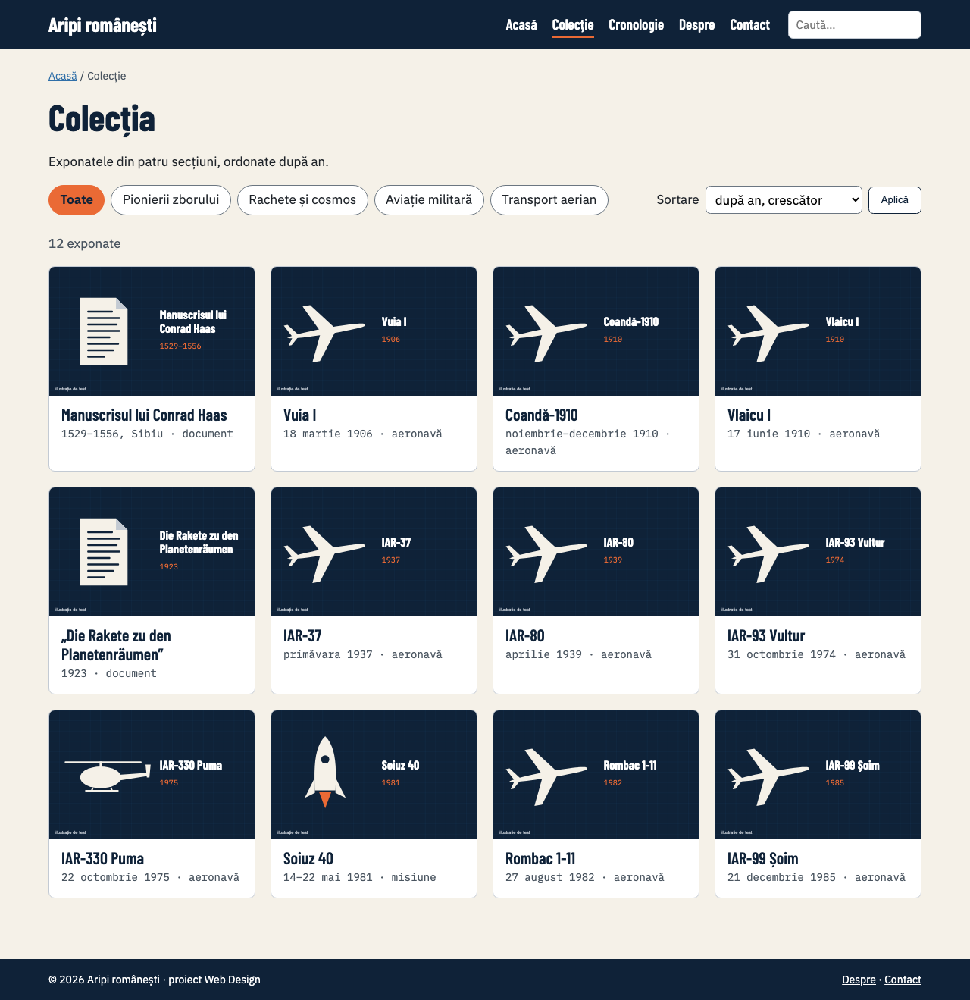
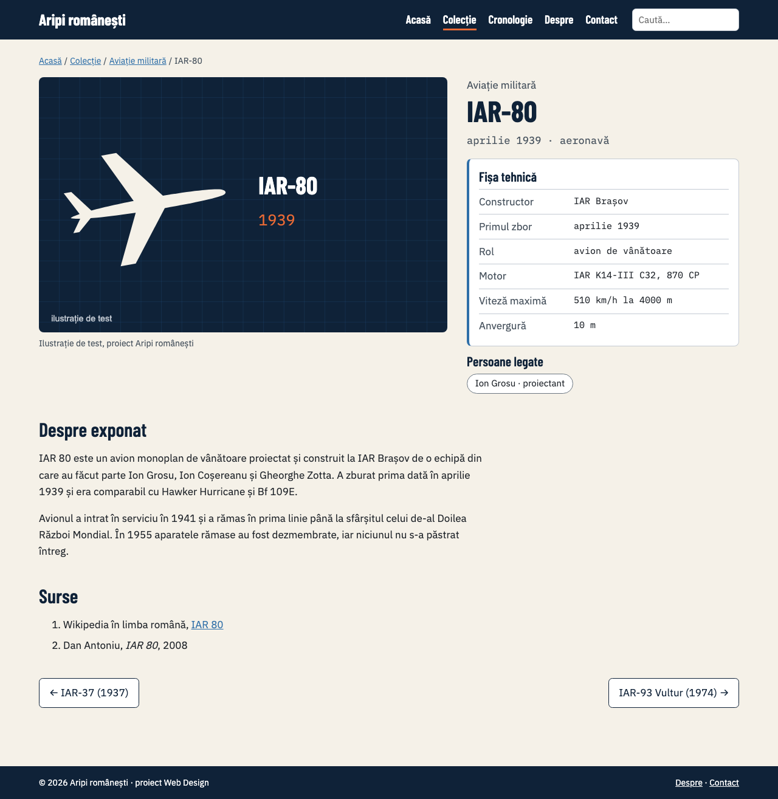

# Aripi românești

Proiect Web Design: expoziția virtuală „Aripi românești — 12 repere ale zborului”, în PHP și MySQL,
rulată local în MAMP 7.4 (Apache 2.4.66, MySQL 8.0.44, PHP 8.3.30).

Depozit: https://github.com/magyproduction/aripi-romanesti

## Etapa 3

### 1. Paginile principale și secundare, meniul și scheletul grafic

| Pagină | Tip | Fișier |
|---|---|---|
| Acasă | principală | `index.php` |
| Colecție | principală | `colectie.php` |
| Exponat | principală | `exponat.php?slug=…` |
| Cronologie | secundară | `cronologie.php` |
| Despre | secundară | `despre.php` |
| Contact | secundară | `contact.php` |
| Căutare | secundară | `cautare.php?q=…` |

- Meniul și scheletul comun sunt în `includes/header.php` și `includes/footer.php`, incluse cu `require` în fiecare pagină.
- HTML semantic: `header`, `nav`, `main`, `article`, `section`, `figure`, `dl`, `footer`, fir de navigare.
- Layout responsiv în `css/style.css`, cu CSS Grid: 4 coloane de exponate pe desktop, 2 pe tabletă, 1 pe telefon.
  Sub 768 px meniul se strânge în butonul „Meniu” (`js/meniu.js`).

### 2. Tabelele și minimum 12 exponate de test

- `sql/schema.sql`: cele 9 tabele din etapa 1.
- `sql/seed.sql`: 12 exponate de test, fiecare cu descriere, fișă tehnică, imagine, persoane legate și surse.
  Datele sunt verificate în sursele trecute la fiecare exponat; imaginile din `img/exponate/` sunt ilustrații de test.

### 3. Pagina de colecție și cea de detaliu, alimentate din baza de date

- `colectie.php` citește exponatele din tabelul `exponate`, cu filtru pe secțiune (`?sectiune=…`) și sortare după an.
- `exponat.php?slug=…` citește fișa din `exponate`, `imagini`, `specificatii`, `persoane` și `surse`,
  cu legături spre exponatul anterior și următor după an. Un exponat inexistent afișează pagina 404.

## Pornire

1. Copiază folderul proiectului în `/Applications/MAMP/htdocs` și pornește serverele din MAMP (Start).
2. În phpMyAdmin (http://localhost:8888/phpMyAdmin5/) importă `sql/schema.sql`, apoi `sql/seed.sql`.
3. Copiază `includes/config.example.php` ca `includes/config.php` (conține deja valorile implicite MAMP).
4. Deschide http://localhost:8888/aripi-romanesti/.
