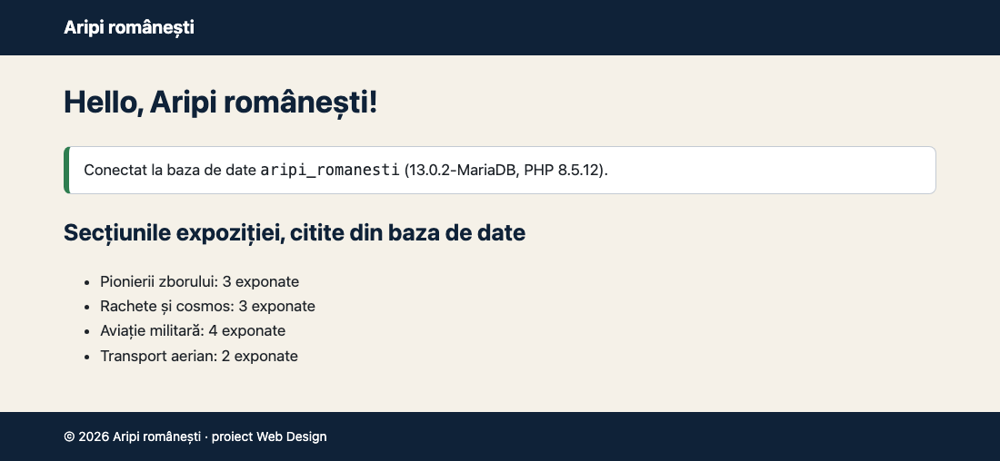

# Aripi românești

Proiect Web Design: expoziția virtuală „Aripi românești — 12 repere ale zborului”.

## 1. Platforma aleasă

PHP, fără framework, cu baza de date MariaDB. Site-ul are puține pagini, iar fiecare pagină
citește direct din bază, deci nu este nevoie de WordPress, Laravel sau CodeIgniter.

## 2. Mediul offline

Instalat local, pe macOS:

- PHP 8.5.12
- MariaDB 13.0.2, pornit ca serviciu (`brew services start mariadb`)
- serverul web integrat din PHP: `php -S localhost:8000`

Proiectul rulează la fel și în XAMPP (folderul se copiază în `htdocs`).

## 3. Depozitul Git

https://github.com/magyproduction/aripi-romanesti

`.gitignore` exclude `includes/config.php`, fișierul cu parola bazei de date.

## 4. Pagina „Hello”

`index.php` se conectează la baza `aripi_romanesti` și afișează secțiunile expoziției citite din tabelele `categorii` și `exponate`.

## Pornire

1. Importă `sql/schema.sql`, apoi `sql/seed.sql` (din linia de comandă `mariadb` sau din phpMyAdmin).
2. Copiază `includes/config.example.php` ca `includes/config.php` și completează utilizatorul și parola bazei.
3. Rulează `php -S localhost:8000` și deschide http://localhost:8000.
